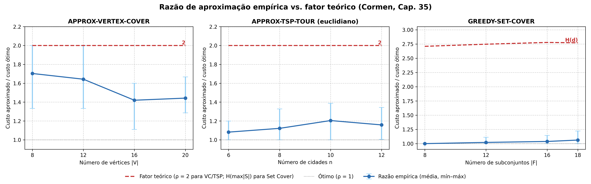

# Tema 6: Problemas NP-Completos e Aproximações
## Parte 4: Algoritmos de Aproximação e Razão Empírica (Capítulo 35)

**Integrante:** Heitor Henrique (Pessoa 4)  
**Disciplina:** Estratégias Avançadas de Projeto e Análise de Algoritmos  
**Professor:** Michel Pires da Silva — DECOM / CEFET-MG  
**Livro-Base:** Cormen et al., *Algoritmos: Teoria e Prática* (Cap. 35)

---

# 1. A Filosofia das Aproximações

> *"Se não podemos encontrar a solução ótima em tempo viável, até onde podemos nos afastar dela com garantias matemáticas?"*

- **O Dilema da Intratabilidade:**
  - Como o Kairo acabou de demonstrar, problemas NP-difíceis não admitem soluções exatas em tempo polinomial (salvo se $P = NP$).
  - A indústria (logística, redes, genômica) não pode esperar séculos por uma resposta.
- **A Abordagem dos Algoritmos de Aproximação:**
  - Abre-se mão da **perfeição estrita** em prol da **eficiência temporal**.
  - **Diferença crucial para heurísticas puras:** existe uma **garantia matemática formal** de que o custo da solução encontrada não se afasta da solução ótima além de um fator $\rho(n)$.

---

# 2. Definição Formal da Razão de Aproximação

Dizemos que um algoritmo possui **razão de aproximação $\rho(n)$** se, para qualquer entrada de tamanho $n$:

$$\max \left( \frac{C}{C^*}, \frac{C^*}{C} \right) \le \rho(n)$$

Onde:
- $C$ é o custo da solução gerada pelo algoritmo aproximado.
- $C^*$ é o custo da solução ótima absoluta.
- Para problemas de **minimização** (como os três do nosso trabalho), temos:
  $$C^* \le C \le \rho(n) \cdot C^*$$

Se $\rho(n) = 2$, garantimos que a resposta **nunca custará mais que o dobro** do ótimo, rodando em tempo polinomial!

---

# 3. Algoritmo 1: APPROX-VERTEX-COVER (Cap. 35.1)

- **O Problema:** Encontrar o menor conjunto de vértices $C \subseteq V$ que cubra todas as arestas de $G$.
- **Ideia Genial do Cormen:** Em vez de tentar escolher vértices (o que é exponencial), focamos nas **arestas**!

```text
APPROX-VERTEX-COVER(G)
1  C = ∅
2  E' = G.E
3  while E' ≠ ∅
4      seja (u, v) uma aresta arbitrária de E'
5      C = C ∪ {u, v}
6      remova de E' toda aresta incidente em u ou em v
7  return C
```

- **Complexidade:** $O(|V| + |E|)$ — linear e instantâneo!

---

# 4. Prova do Fator 2: Emparelhamento Maximal

Por que o `APPROX-VERTEX-COVER` garante no máximo o dobro do ótimo?

1. As arestas escolhidas na linha 4 formam um **emparelhamento** $A$: nenhuma aresta de $A$ compartilha vértices entre si.
2. Qualquer cobertura válida (inclusive a ótima $C^*$) precisa de **pelo menos um vértice** em cada aresta independente de $A$:
   $$|C^*| \ge |A|$$
3. O nosso algoritmo selecionou **ambos os extremos** de cada aresta de $A$:
   $$|C| = 2 \cdot |A|$$
4. Logo:
   $$|C| = 2 \cdot |A| \le 2 \cdot |C^*|$$

**Conclusão:** 2-aproximação polinomial estritamente comprovada!

---

# 5. Algoritmo 2: APPROX-TSP-TOUR via MST (Cap. 35.2)

- **O Problema:** Rota fechada de menor distância visitando todas as $n$ cidades (TSP Métrico com desigualdade triangular).

```text
APPROX-TSP-TOUR(G, c)
1  selecione um vértice r ∈ G.V como raiz
2  T = MST-PRIM(G, c, r)               # Conecta tudo com Árvore Geradora Mínima
3  H = lista de vértices em percurso de PRÉ-ORDEM de T (com atalhos diretos)
4  return o ciclo hamiltoniano H
```

- **Complexidade:** $\Theta(V^2)$ usando o Algoritmo de Prim em grafo completo.

---

# 6. Prova do Fator 2 do TSP: Prim + Atalhos

1. **A Árvore é menor que o Ótimo:** Removendo uma aresta da rota ótima $H^*$, obtemos uma árvore geradora. Logo, a menor árvore possível ($T$) custa menos que o ótimo:
   $$c(T) \le c(H^*)$$
2. **O Passeio Completo:** Caminhar pela árvore duplicada (ida e volta em cada galho) custa $2 \cdot c(T)$.
3. **Desigualdade Triangular nos Atalhos:** Como pulamos cidades repetidas direto pela linha reta, pela desigualdade triangular o atalho não aumenta o custo:
   $$c(H) \le 2 \cdot c(T) \le 2 \cdot c(H^*)$$
- **Atenção:** Sem desigualdade triangular, o TSP geral não admite nenhuma aproximação constante (Teorema 35.3 do Cormen).

---

# 7. Algoritmo 3: GREEDY-SET-COVER (Cap. 35.3)

- **O Problema:** Universo $X$, família $\mathcal{F}$ de subconjuntos. Achar a menor quantidade de subconjuntos cuja união cubra todo o universo $X$.
- **Estratégia Gulosa:** A cada passo, selecione o subconjunto $S$ que cobre a **maior quantidade de elementos ainda descobertos**!

```text
GREEDY-SET-COVER(X, F)
1  U = X;  C = ∅
2  while U ≠ ∅
3      selecione S ∈ F que maximize |S ∩ U|
4      U = U − S
5      C = C ∪ {S}
6  return C
```

- **Garantia Teórica:** Fator Harmônico $H(d) = \sum_{i=1}^d \frac{1}{i} \le \ln(d) + 1$, onde $d = \max |S|$.

---

# 8. Resultados Experimentais: Razão Empírica

Executamos os 3 algoritmos aproximados contra as soluções exatas nas **mesmas instâncias** (semente fixa):



- **Linha Vermelha:** Fator Teórico do Cormen (o pior caso garantido).
- **Linha Azul:** Razão média empírica ($\frac{\text{Custo Aprox}}{\text{Custo Ótimo}}$).

---

# 9. Análise dos Resultados e Conclusões

| Algoritmo | Complexidade | Fator Teórico | Razão Empírica Média | Tempo de Execução |
|---|---|---|---|---|
| **Vertex Cover** | $O(V + E)$ | $\rho = 2$ | **1.42 – 1.70** | $0.005\text{ ms}$ |
| **TSP (Métrico)** | $\Theta(V^2)$ | $\rho = 2$ | **1.08 – 1.20** | $0.098\text{ ms}$ |
| **Set Cover** | Polinomial | $H(d) \approx 2.75$ | **1.00 – 1.06** | $0.060\text{ ms}$ |

- **Destaques:**
  1. **100% das instâncias** respeitaram rigorosamente o teto teórico.
  2. Na prática, o TSP ficou apenas **10% a 20% acima do ótimo**, e o Set Cover praticamente achou a solução ótima (1.06x)!
  3. O ganho de tempo foi de **milhares de vezes** em relação às abordagens exatas.

---

# 10. Transição para Metaheurísticas e Estudo de Caso

- **Onde as aproximações têm limites?**
  - Nem todos os problemas NP-difíceis admitem fatores de aproximação pequenos ou constantes (alguns são inaproximáveis!).
  - Em espaços de busca contínuos e hiperdimensionalmente complexos — como o **Molecular Docking** (ligação ligante-proteína com dezenas de torções angulares) —, métodos gulosos podem ficar presos em ótimos locais.
- **Passo a palavra para a Jade (Pessoa 5):**
  - Ela apresentará as **Metaheurísticas** (Simulated Annealing e Algoritmos Genéticos), capazes de explorar paisagens de energia acidentadas em problemas biológicos reais!
